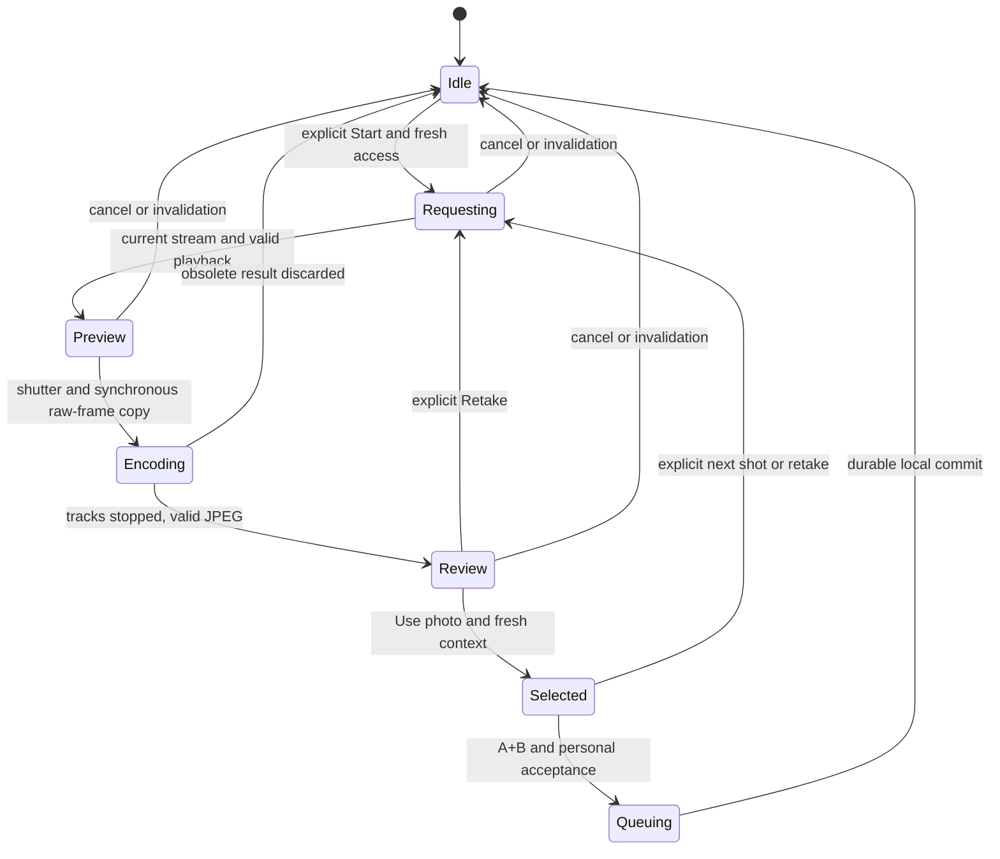

# Optional live browser camera guide — approved design

WP-COLLECT-4, SPEC v17 §5.2, [design issue #88](https://github.com/global-soil-intelligence/gsip/issues/88). Source baseline: merged main `a2529906a320b2be0339c48cf8dce2b6688f58cf` after owner-approved #86 then #87. Justin approved merging [#89](https://github.com/global-soil-intelligence/gsip/pull/89) and the reviewed source-build sequence with a subsequent “go”. [COLLECT-4A #90](https://github.com/global-soil-intelligence/gsip/issues/90) prepares the pure session/queue/shared-writer boundary; live preview is still 4B, after reviewed/green/merged 4A. **This document itself grants no implementation, merge, camera/device access or production authority.** The owner's separate source go supplies bounded implementation authority only; no live camera feature has been built or exercised by 4A.

## Proposed product and owner review choices

A person may choose an optional framing guide for a new invited-browser observation. The camera shows a plain soil outline; the person captures A and B, reviews each, enters context, personally accepts the grant and queues the observation. The physical reference card stays optional. The guide is never a photographed marker, physical ruler, colour reference or measured spectrum.

| Choice           | Recommended first version in this proposal                                                                        | Deferred alternative                                                                                            |
| ---------------- | ----------------------------------------------------------------------------------------------------------------- | --------------------------------------------------------------------------------------------------------------- |
| Audience         | Existing-account invited browser pilot only; all existing admission gates must be open                            | Ordinary/anonymous browser and native embedded preview need later scope                                         |
| Capture pipeline | One full-frame video-to-JPEG path; fixed resource bounds and visible quality limits                               | ImageCapture stills, manual controls, RAW and native camera overlays                                            |
| Draft model      | Separate empty-observation guide mode, RAM until one owner-bound queue commit                                     | Mixing sources, replacing persisted shots and restart recovery require owner/selection metadata first           |
| Fallback         | Return to today's camera/gallery path; confirm discard of unqueued guide selections                               | Preserve/mix guided and picker photos only after the draft-ownership prerequisite                               |
| Background       | Stop camera/discard pending work; accepted RAM photos may remain held, hidden until fresh same-context validation | Discard all guide photos on every background event is stricter but loses work during intentional file selection |
| Initial bounds   | 1280 long edge / 720 short edge minimum for optional guide output, max 2048 per edge and 4,194,304 pixels         | Change only after staged device/quality evidence and reviewed scope                                             |

These are proposed engineering choices for owner review, not measured scientific thresholds or opening approval. A low-resolution feed falls back to the existing picker; it does not change global photo admission or weaken QA. Approval of the design and an implementation go are distinct. Public/canonical collection remains separately gated.

## Invariants and exclusions

Preserve I1–I15, L1–L7 and B1–B8, required A+B/optional C, land-access permission and personal terms acceptance. Keep the ordinary observation versus optional library sample distinction, real depth bounds, exact queued identities/bytes, private invited membership, withdrawal, quotas, holdout and publication holds. A browser snapshot remains uncalibrated RGB source evidence. No automatic summary extraction, library sample, lab verification, provenance promotion or biological prediction.

Add no dependency, paid/closed service, native code, native permission, new database/store/version, backend schema, API or activation flag. Keep Android's no-CAMERA/no-microphone policy, native plugin options and all closed-SDK/permission/secret checks unchanged. Default Pages/native artifacts retain both activation flags false. Rights recovery may authenticate the existing person; it never starts the guide.

No microphone, MediaRecorder, peer connection, frame upload, telemetry, device enumeration, retained device identifier, capability fingerprint or raw error/stack logging. Camera frames and selected photos stay local until the existing explicit Queue observation action; ordinary private sync occurs only after its existing checks. Stopping and releasing references is not proof of physical RAM erasure, browser/OS snapshot exclusion or cloud-backup behavior.

## Eligibility and interaction

Eligibility is `pilot && !native && !rightsView && libraryLive && canCollect && !rightsHold`, plus a fresh verified nonanonymous owner, compatible open pilot admission and known queue revision. Do not use `canCollect` alone: it does not encode the library build gate. Test every conjunct. Require a top-level secure browser context and the required media/dialog/canvas methods; unsupported environments retain the picker without permission calls.

Entry is a new **guide-only observation**, not a per-shot overlay on existing drafts. Finish initial draft restoration and every pending picker read. Require all in-memory picker selections and persisted photo slots empty; do not treat a stale empty check as a commit guarantee. Existing photos are not erased automatically. If present, offer the existing explicit all-draft discard, explain its effect, await success and verify emptiness/revision again before starting. Never delete an unowned per-shot draft. An existing library draft is allowed only when its owner, revision and full context are known and match the current guide session; foreign/unowned or ambiguous context holds entry.

Use an accessible modal with labelled shot, keyboard-operable Shutter/Use photo/Retake/Cancel, Escape cancellation, focus return and polite status. No overlay is drawn into the image. The camera opens only from a fresh explicit Start camera action, with video only and rear-facing preference. A permission denial is a normal fallback outcome; do not repeatedly prompt or automatically launch the OS camera. Selecting fallback closes/stops the guide and focuses the existing picker control; the person initiates that separate action.

Before switching to picker mode, confirm loss when guide selections exist. Clear only guide RAM, invalidate all guide work and then restore the unchanged picker path. Do not mix source modes or silently retain some guide shots. Cancelling an in-guide retake preserves the last accepted RAM selection; invalid/pending replacements never erase an accepted selection. No existing saved picker selection is replaced by a RAM guide image, so a restart cannot silently restore a superseded picker image.

Guide selections are labelled **not saved until queued**. Reload/close can lose them; no restart or backup protection is claimed. Native and ordinary legacy browser behavior remain unchanged. The temporary guide-output tradeoff is deliberate; anyone needing gallery mixing, maximum still resolution or restart-safe drafts uses today's camera/gallery path.

## Session state and asynchronous ownership

The modal/controller and observation session have separate lifetimes. Keep session ID, observation intent, nonanonymous owner UID, auth generation, device queue revision, per-shot intent and accepted CapturedPhoto slots in RAM. A request also has its own generation so cancelled permission/playback/encoding callbacks cannot become current again. Keep selected guide slots separate from `nativePhotos`, `DraftPhoto` and restored picker state.

At most one active controller, one unresolved getUserMedia request, one owned video track and one unresolved encoder exist per page. A UI timeout does not cancel the browser promise. Attach the late-result disposal handler when creating the request: obsolete streams stop their own tracks immediately, never an unrelated new stream. Do not issue another request/encoder while the previous unresolved operation still occupies its slot; retain the fallback. Check context after every await, including permission, playback, fresh access, encoding, Blob conversion, Use photo and queue completion. Photo/session identifiers and private error details are never logged.

Before every start, shutter, Use photo and queue attempt, refresh the same nonanonymous owner and pilot admission through App's existing client. Pass only a current context predicate and generation tokens to the guide; the UI/controller import no auth, Supabase or queue implementation. Never create an anonymous account or revive an old session for camera access.

Active-visible access refresh runs at most once every five seconds, with one outstanding refresh, five-second soft timeout and a 15-second positive lease. App's existing focus/auth refresh callbacks and the guide timer must share that single-flight boundary; unresolved timed-out work cannot overlap a replacement refresh. Explicit start/shutter/use/queue requests obtain a fresh result through it or hold, rather than trusting an old lease. Expiry, unknown/closed state, mismatched owner or failed refresh stops camera work and holds/discards unusable results. Poll queue revision at most once a second while visible guide work exists; never poll on ordinary closed/rights/native pages. Check the actual current revision again at every commit. Browser timers are not real-time; server revocation is observed through these checks, not instant push notification. An elapsed lease can never authorize a shutter or commit just because a timer callback was delayed.

Cancel, Escape, fallback, route/rights/auth change, queue clear/revision change, lost admission, unmount, hidden/pagehide and video track mute/end invalidate the relevant controller before cleanup. Stop all returned tracks, pause/detach the video, release canvas/Blob/object URLs and remove owned listeners/timers. Explicit stop must perform cleanup itself rather than wait for an ended event.

On background/pagehide, discard pending request/encode/review work and stop all camera tracks. Previously accepted guide photos may remain held in RAM and must not be displayed or used until foreground fresh owner/auth-generation/revision/admission checks match the original session. Resume requires an explicit action; no automatic camera restart on focus, pageshow, network return or permission restoration. Any auth/rights/revision or observed admission mismatch discards the whole guide session. A persistent operation may require its own asynchronous cleanup; do not repopulate an obsolete session from its eventual callback.

## Frame geometry, encoding and resource bounds

The standard media API exposes local streams and optional constraints; secure-context, permission and playback behavior still vary by browser. Use inline muted video and explicitly handle playback rejection. [W3C Media Capture](https://www.w3.org/TR/mediacapture-streams/), [WebKit video policy](https://webkit.org/blog/6784/new-video-policies-for-ios/)

Request video with rear-facing preference, ideal 1920×1440 and maximum 2048 for either dimension; audio is false. Do not require a particular camera ID or inspect/persist device labels. Unsupported constraints or negotiated dimensions outside the guide limits return to the picker. No camera switching, torch, exposure/white-balance lock, crop or automatic scene detection in version one.

Show the full, unmirrored frame using contain layout; position a plain SVG outline in the actual video-image rectangle, excluding letterboxing. Keep instructions outside the encoded plane. At shutter, validate current frame readiness and intrinsic video dimensions, then synchronously draw the complete current video frame to one matching canvas with no intervening await. Output dimensions come from that frame, not element layout, devicePixelRatio or screen orientation. Do not flip, rotate from screen angle, stretch, crop, upscale, sharpen or add application colour correction/normalization. Browser colour conversion and lossy JPEG encoding are expected; this is not calibrated raw-sensor preservation. Rotation/resizing must refresh preview geometry before shutter is enabled.

The HTML standard defines intrinsic video dimensions and canvas drawing/serialization; JPEG requests may fall back to PNG, and quality is implementation-dependent. Validate the actual result rather than relabelling it. [HTML video dimensions](https://html.spec.whatwg.org/multipage/media.html#dom-video-videowidth), [HTML canvas](https://html.spec.whatwg.org/multipage/canvas.html#dom-context-2d-drawimage)

After the raw frame is copied, stop tracks immediately, then request JPEG once at quality 0.92. Require actual image/jpeg MIME, JPEG header, nonempty bytes and matching decoded output dimensions, within the existing 12 MiB limit. Refuse null, wrong-format, decode or allocation failures generically; never iteratively crush quality or relabel PNG/HEIC. Canvas output may contain colour-profile metadata: retain server sanitization, and invent no EXIF, GPS, device attestation or camera calibration. Timestamp at shutter and method camera remain client claims; backend provenance rules stay unchanged.

Before allocating canvas/decode buffers, enforce 2048 per edge and 4,194,304 pixels; guide output must have long edge at least 1280 and short edge at least 720. These are provisional optional-guide engineering bounds, not scientific acceptance thresholds. Keep at most three accepted photo buffers plus one candidate, at most 50,331,648 encoded bytes total, one canvas and one encoder. Browser/video/codec internal allocations are outside this bound; do not advertise a whole-process memory guarantee. Release replaced/cancelled buffers and revoke object URLs. Device testing must evaluate low-memory behavior and fallback.

Permission wait UI expires at 20 seconds, playable-frame wait at 10 seconds, a live preview at 60 seconds and encoder wait at 10 seconds. Timeout invalidates work but does not pretend an underlying promise is cancelled; its slot and disposal continuation remain until settled. No stream stays live while reviewing a JPEG. Retake/next shot always requires a new explicit start.

ImageCapture.takePhoto is deliberately deferred: it uses a distinct still-photo operation and would add another orientation, format and framing branch. A video-frame JPEG may have lower detail than the system camera. Show that tradeoff and retain the full-resolution picker path; no universal-phone or accuracy claim. [W3C Image Capture](https://www.w3.org/TR/image-capture/), [Chrome Image Capture](https://developer.chrome.com/blog/imagecapture/)

## Atomic owner-bound queue handoff

This is a small **new queue transaction behavior**, not a claim that today's enqueue is already sufficient. `DraftPhoto` has no owner field, and its writes do not advance queue revision. A late picker write at the same revision must not be overwritten or erased. Do not add guide bytes to that store or try to fix this with a non-atomic empty check or byte-only per-shot deletion.

1. Once A+B, optional C, context and personally accepted rights are ready, freeze one immutable pending QueueRecord snapshot using existing UUID/terms/provenance formats. Prevent double clicks or later edits from generating new identities for the same pending attempt. Capture no guide frame implicitly at submission.
2. Refresh the current same owner/auth/rights/admission. Existing-record outcome reconciliation runs before original revision/session checks; those checks gate NEW insertion in step 4. Apply existing real-depth/strict declaration validation only for explicit library opt-in. Skip every guide-photo saveDraftPhoto call, including the library submit pre-save. No summary or sample is invented for opt-out.
3. Use one bounded readwrite transaction over existing submissions, queueState, draftPhotos and libraryDraft stores. Recheck current local owner/auth/rights/access. First reconcile any existing record at the frozen submission identity: require the same owner and identical immutable IDs/photo bytes/context/acceptance, preserve stored mutable sync/reconfirmation progress, and neither consume context nor advance revision again. This handles uncertain successful completion even though its library draft was consumed. A mismatch holds; never overwrite. If no record exists and the original revision/session is stale, hold with the same identity; never invent a new observation or claim a hosted receipt.
4. For a NEW insertion, recheck the original generation/session/shot predicate and that ALL persistent photo slots are empty. A concurrent picker write before this check holds the save without deleting it. If library opt-in exists, require its saved owner UID exactly matches the guide owner, its deviceRevision matches, and its full IDs/context/declaration bytes match the frozen snapshot. Atomically consume only that exact owned library draft. With no opt-in, require no hidden saved library draft. Do not erase a different/newer context or change any namespace.
5. Insert the existing owner-bound QueueRecord and atomically advance existing queueState revision from r to r+1 for every NEW guide commit, including opt-out. This completion fence prevents old same-revision photo/library operations from restoring the completed observation. Return the committed successor revision; await transaction completion before clearing RAM. Keep the frozen pending identity/outcome separate from camera session invalidation: observing its own successor revision stops camera work but cannot erase that pending outcome before reconciliation. Auth/rights loss still hides/releases private RAM and never authorizes reinsertion; uncertainty must not mint new IDs. Old sync checkpoints pause under existing revision checks; other queued records are retained for fresh retry, never rewritten or deleted by this operation.
6. Existing draft writers must retain their original operation revision. Library context with missing/ambiguous deviceRevision holds for explicit discard/restart; it must never acquire the latest revision via the current fallback. Stale save refusal must be observable by callers: do not report ready or retain a ghost picker selection after persistence refuses it. Require a fresh user retry, not automatic revision rebinding. Coordinate pending library edits/declaration reads as well as picker reads; invalidate their old intent on completion.
7. Success clears only this guide session/form state and triggers existing queue refresh/sync checks. It MUST NOT call blanket clearDraftPhotos. Pre-completion writes arriving later are refused at their old revision; genuinely new picker/library writes started at the successor revision survive. Failure/cancel/auth change clears no unrelated persisted row. Existing explicit rights/queue/draft clear retains its separately authorized behavior. Normal successful picker/native capture remains the same; narrow stale-operation refusal/feedback is a deliberate shared-writer correction.

There is no new store, IndexedDB version, QueueRecord/backend format, grant format/acceptance flow, sync protocol, RLS or Supabase migration. The exact transaction, rollback, conflict and consume behavior must be implemented/tested in COLLECT-4A before UI integration. Queueing is durable local storage; a hosted receipt still requires existing authenticated intake and its independent gates.

## Exact future source scope and stages

| Stage      | Proposed files                                                                    | Allowed change                                                                                                                                          |
| ---------- | --------------------------------------------------------------------------------- | ------------------------------------------------------------------------------------------------------------------------------------------------------- |
| COLLECT-4A | New apps/capture-pwa/src/guideSession.ts and its tests                            | Pure session/selection/identity fences and frozen queue snapshot; no camera, auth import or storage side effect                                         |
| COLLECT-4A | apps/capture-pwa/src/queue.ts, existing queue/library tests                       | Guarded existing-store insertion/exact consume/revision fence, identity reconciliation and observable stale-writer refusal; no schema/version change    |
| COLLECT-4A | apps/capture-pwa/src/App.tsx, src/LibrarySection.tsx and targeted tests           | Preserve original writer revision/intent; hold missing revisions; show refused saves honestly; fence pending library reads/edits; no camera integration |
| COLLECT-4B | New apps/capture-pwa/src/platform/browserCamera.ts and controller tests           | Owned video request/frame/encoder ports, JPEG bounds, timers and late-result disposal                                                                   |
| COLLECT-4B | New apps/capture-pwa/src/BrowserPhotoGuide.tsx and component tests                | Accessible preview/SVG/review controls; no auth/storage/network integration                                                                             |
| COLLECT-4B | apps/capture-pwa/src/App.tsx, src/styles.css and targeted app/pilot/library tests | Derived pilot eligibility, separate guide mode, guarded handoff, lifecycle/fallback and honest local status                                             |
| COLLECT-4B | tests/e2e/browser-camera.spec.ts, targeted invited-pilot fixture/harness tests    | Synthetic local media/pixel/closed-view proof, never an actual sensor or publishable open artifact                                                      |

Read existing CapturedPhoto/MAX_PHOTO_BYTES/isJpeg from platform/types.ts and platform/camera.ts; do not change native camera options or routes. Reuse App's existing admission client and queue/rights contracts. If implementation needs another source file, dependency, native effect, activation flag, store/version or privileged interface, stop and amend the scope before adding it. Pure tests and synthetic local browser media do not grant actual-camera/device authority.

## Negative-first implementation acceptance

| Area                    | Required failure-before / regression proof                                                                                                                                                                                                                                                  |
| ----------------------- | ------------------------------------------------------------------------------------------------------------------------------------------------------------------------------------------------------------------------------------------------------------------------------------------- |
| Closure and consent     | Zero media calls on mount, closed/default/native/rights or failed eligibility; one explicit start, audio false, no enumeration/anonymous sign-in                                                                                                                                            |
| Session identity        | Owner/auth/revision/observation/shot changes during every await stop/drop obsolete work; successful queue cannot refill the next observation                                                                                                                                                |
| Pending resources       | Ignored prompt, late stream, late playback/Blob/encode, timeout, replacement and double-click never overlap unresolved requests/encoders or leak tracks                                                                                                                                     |
| Geometry and evidence   | Asymmetric synthetic frame/corner markers retain orientation and full bounds across wide/tall/rotated layouts; SVG visible in preview but absent in actual decoded JPEG                                                                                                                     |
| Output bounds           | Boundary/excess dimensions, byte limits, wrong/null MIME/header, decode/alloc/playback failure; no CSS-sized output, upscale or quality loop                                                                                                                                                |
| Picker isolation        | Saved draft/pending restore/picker read blocks entry; explicit discard awaited/verified; mixed sources refused; fallback confirms RAM loss and preserves unrelated persisted data                                                                                                           |
| Atomic race safety      | Picker/library write in either transaction order: before commit holds/must match; old-revision writes after completion refuse observably, successor-revision fresh drafts survive; abort rolls back insertion, exact consume and revision advance; rights clear both orders                 |
| Library and idempotence | No pre-queue guide bytes in any GSIP-managed persistent store; A+B/C unchanged; no sample/depth invented; strict matched optional context; missing revision never rebounds; uncertain success reconciles before consumed-draft checks with stable IDs and no repeat bump/progress overwrite |
| Lifecycle               | Hidden/pagehide/unmount/mute/end stops streams; pending candidate discarded; held accepted photos require fresh same-context validation before display/use; no auto camera resume                                                                                                           |
| Existing safeguards     | Cardless/uncalibrated QA, default closed manifests, invited rights/account deletion, ownership, queue/clear/retry, native backup/permission/SDK and secret checks remain green                                                                                                              |

The prospective JSON manifest and its mutation tests freeze this review scope; they exercise no camera and establish no runtime capability. COLLECT-4A/4B implementation tests must first fail against missing/wrong behavior, then pass. Use synthetic asymmetric media and injected ports for races. Pixel exclusion requires actual canvas/JPEG decoding, not just DOM assertions or a mocked encoder. Exercise Chromium and WebKit; record any API fallback explicitly rather than treating it as successful capture.

## Qualification and held authority

After source/CI review and a separate device go, qualify actual recent/older iPhone Safari and installed PWA, Android Chrome and a lower-memory/vendor device. Record actual negotiated/output dimensions, camera detail against the system picker, rotation/mirroring, permission denial/ignored prompt, background/lock/calls, repeated retakes, memory failure and JPEG/HEIC gallery fallback. Use staged synthetic specimens and no contributor data. Queue/withdrawal/rights and server QA remain mandatory; device quality is distinct from scientific validation.

Owner review should explicitly accept the first-version no-mixing/reload-loss/quality tradeoffs or choose the separate owner-bound durable-draft prerequisite. Neither option changes calibration, measurement tiers, licences or launch gates. No actual camera, field sample, account/invitation, worker, production query/migration, Pages deployment, capture/library opening or private-data transfer is performed by this design. Default source artifacts and live collection remain closed.
