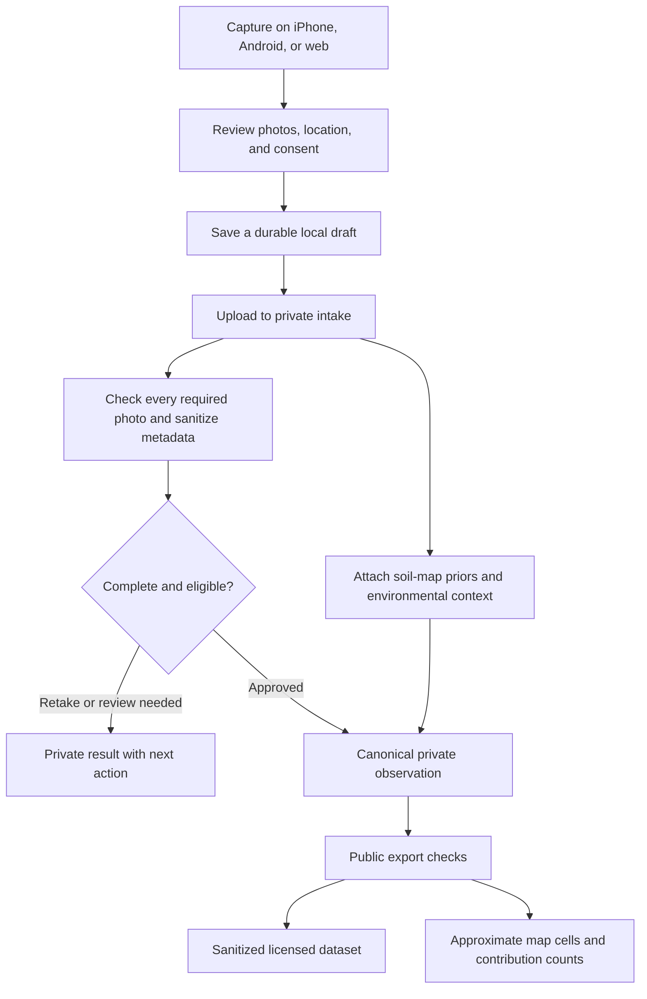

# GSIP — mobile app and system blueprint

Date: 2026-09-14

## Product direction

Build an open-source soil intelligence mapping project with iPhone and Android apps, a public web map, and reusable research datasets. People contribute standardized soil photographs; the system checks quality, adds existing soil-map context, and publishes approved observations at coarse geographic resolution. Validated models can later turn the growing dataset into improved estimates.

This blueprint records the requested mobile direction. The existing specification puts Capacitor app-store builds in Phase 4; the proposed sequence below brings mobile delivery forward. It is a planning document, not a claim that native apps or a trained estimator exist. Implementation should update the governing build order to match this direction.

## 1. What a person does

1. Open GSIP and explore the public soil map without creating an account.
2. Choose **Capture** and follow a short field guide.
3. Photograph the ground surface with a reference card, then a freshly exposed soil face. Optionally add a moist texture photo.
4. Record land cover, surface moisture, and whether the ground was disturbed.
5. Share a location for this observation and preview the approximate cell that could become public.
6. Review the photographs, choose public attribution, and accept the contribution terms.
7. Save the observation on the phone, even without reception.
8. Upload when connectivity returns. See separate saved, uploaded, quality-review, and published states.
9. Revisit the observation to see its quality result and available soil-map context.

The reference card provides a consistent visual reference. It does not turn a camera into a laboratory instrument. Card-less observations remain possible and should be labeled uncalibrated; an optional photo must not imply a measured confidence improvement before validation.

## 2. Proposed mobile navigation

| Tab             | Purpose                                    | Main screens                                                                           | Current foundation                                                  |
| --------------- | ------------------------------------------ | -------------------------------------------------------------------------------------- | ------------------------------------------------------------------- |
| Explore         | Understand the soil context around a place | Map; carbon/pH/clay layers; contribution cells; cell detail                            | Separate web map exists                                             |
| Capture         | Add a useful field observation             | Photo guide; camera; location; field conditions; consent; review                       | Browser capture flow exists                                         |
| My observations | Know what happened to each contribution    | Drafts; upload queue; quality results; published observations; retry or retake         | Offline queue exists; full history and status screens need building |
| Learn           | Make better observations                   | Protocol; printable card; reading the map; limitations; open-science methods           | Public website and card resources exist                             |
| Account         | Manage identity and privacy                | Optional sign-in; attribution; permissions; account/data requests; project information | Anonymous and email sign-in exist; linking and management need work |

Keep an anonymous first contribution possible. Offer a persistent account for cross-device history, with correct identity linking. Make personal observation detail private; the public map shows aggregate geographic cells.

## 3. Intended observation lifecycle

This diagram describes the target lifecycle. The review found that current QA can approve incomplete photo sets; that must be fixed before using this flow for public intake. Priors may be unavailable: record that explicitly and defer any checks that depend on them rather than silently treating missing context as a passed check.

### User-facing states

- **Draft:** only on this device; editable or discardable.
- **Saved offline:** queued locally; not received by GSIP yet.
- **Uploading:** a resumable transfer is in progress.
- **Received:** the server has the complete contribution; local queue cleanup can proceed.
- **Checking quality:** required photos and context are being evaluated.
- **Needs attention:** explain the failed check and whether a retake or review is needed.
- **Accepted:** eligible for the next publication, subject to export checks.
- **Published:** included in a confirmed dataset release and map update.

These are proposed product states, not the current database enum. Publication must have its own recorded receipt; `qa_pass` alone does not mean published.

## 4. What runs where

| Component                           | Responsibility                                                                            | Delivery location                                       |
| ----------------------------------- | ----------------------------------------------------------------------------------------- | ------------------------------------------------------- |
| Shared React/TypeScript app         | Screens, map interactions, capture protocol, validation                                   | Browser and mobile packages                             |
| Capacitor platform layer — proposed | Native camera/location access, app lifecycle, mobile integrations                         | iOS and Android projects                                |
| Durable mobile queue — proposed     | Preserve photos and upload progress across interruption/restart                           | Private on-device files and local database              |
| Supabase backend                    | Authentication, contributor records, exact operational locations, grants, private storage | Separately hosted backend                               |
| QA workers                          | Sanitize images; check blur, exposure, cards, duplicates, and plausibility                | Server-side processing                                  |
| Prior enrichment                    | SoilGrids; SSURGO where applicable; weather and elevation context                         | Server-side API requests                                |
| Publication worker                  | Eligibility checks, privacy checks, licensed exports, map aggregates                      | Scheduled server-side processing                        |
| Public website and map              | Explain the project, show soil context and contributions                                  | Web hosting                                             |
| Public research releases            | Versioned sanitized photographs, structured data, provenance                              | Dataset hosting; existing exporter targets Hugging Face |
| Models — later                      | Train and evaluate against independent lab-paired observations                            | Reproducible training and inference infrastructure      |

The App Store and Google Play distribute the phone applications. They do not replace hosting for the database, photos, workers, map assets, or datasets.

### Mobile implementation recommendation

Reuse the existing React/TypeScript components and add Capacitor. It supports incorporating existing web projects and accessing native iOS/Android features: [Capacitor documentation](https://capacitorjs.com/docs).

Unify capture and map inside one mobile navigation shell rather than loading separate website pages. Keep browser-specific persistence behind an interface, then implement a durable mobile storage adapter. Validate camera format conversion, image orientation, storage limits, location permission denial, sign-in deep links, and interrupted uploads on both platforms.

Provide useful offline capture and restart recovery first. Treat background transfers as an additional capability to validate on each operating system; do not promise uploads will always complete while the app is closed. Full offline map downloads are a separate feature from offline observation capture.

## 5. Privacy and open-source boundaries

- **Public code:** retain the repository's MIT license and document how others can run the system.
- **Public structured dataset:** retain the stated ODbL 1.0 licensing and source attribution.
- **Published photographs:** retain the stated CC BY-SA 4.0 licensing and recorded contributor attribution.
- **Private operational data:** exact locations, authentication data, original uploads, and private camera fields are not open datasets.
- **Public geography:** derive H3 resolution-8 cells from trusted processing; publish approximate areas rather than exact pins.
- **Consent:** show what will be public before submission. Open data licensing and account deletion are different concerns; document the handling of already-published releases and takedown requests before launch.
- **Permissions:** request the camera and observation location when needed. Continuous location tracking is not part of the proposed first release.
- **Operations:** maintain intake controls, raw-upload retention, resumable processing, export provenance, and a practical moderation path.

Open source allows others to inspect, contribute to, and self-host the code. It does not make contributor identities or raw operational data public, and it does not eliminate hosting or distribution costs.

## 6. What “soil intelligence” means by stage

### First mobile release: observations and context

Ship capture, quality feedback, contributions on the map, and clearly attributed existing soil-map estimates. The current code contains this foundation but needs the review fixes and mobile work. Display the origin, depth, units, and available uncertainty of soil context. Do not present an existing map's pH value as a result measured from the user's photograph.

### Research stage: validated estimates

Add lab-paired observations, a soil/non-soil classifier, and models for properties supported by evidence. Separate reference-map priors from laboratory measurements throughout training and evaluation. Publish model versions, independent validation results, failure cases, and uncertainty.

### Later mapping stage: demonstrated improvement

Use validated observations and models to improve maps, show where confidence is low, and direct future sampling. A growing photograph count is a contribution metric; improved accuracy requires independent comparison against suitable reference measurements.

## 7. Delivery sequence

| Milestone                    | Work                                                                                                 | Completion evidence                                                        |
| ---------------------------- | ---------------------------------------------------------------------------------------------------- | -------------------------------------------------------------------------- |
| 1. Reliable core             | Fix incomplete QA approval, closed-intake behavior, worker recovery, and identity linking            | Regression checks plus a complete private capture-to-export run            |
| 2. Unified mobile experience | Shared navigation, observation detail/history, clear statuses, guidance and privacy controls         | Complete journeys in the mobile-sized app                                  |
| 3. Native device integration | iOS/Android projects; camera; location; durable local storage; upload recovery; authentication links | Real iPhone and Android tests, including restart and denied permissions    |
| 4. Controlled beta           | Signed builds, store metadata, support/privacy pages, tester distribution                            | TestFlight and Google Play test builds; documented field feedback          |
| 5. Public release            | Resolve field defects; reconcile current launch gates; finalize operations and store submission      | Approved store releases plus verified working backend and publication path |
| 6. Validated intelligence    | Lab partnerships, models, reproducible evaluation and versioned releases                             | Evidence that estimates meet declared accuracy and uncertainty criteria    |

Apple provides [TestFlight](https://developer.apple.com/testflight/) for beta distribution and applies its [App Review Guidelines](https://developer.apple.com/app-store/review/guidelines/) to store submissions. Camera capture, offline observations, history, and useful maps should form the app experience. Google Play provides [testing and staged release tools](https://play.google.com/console/about/release/). Exact platform submission requirements should be rechecked when preparing the builds.

## First release success criterion

A new contributor can install GSIP on either platform, capture a complete observation without reception, restart the app without losing it, reconnect, receive a clear quality result, and later find the accepted contribution represented in the public map and a traceable dataset release—without exposing exact location or raw image metadata.
