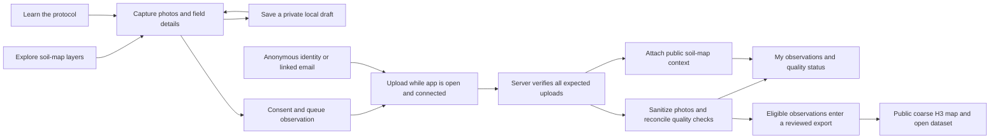

# GSIP mobile build and test handoff

## Result

The shared React app now runs as a browser PWA and inside Capacitor iPhone and Android projects. This is a working development build, with local automated validation and native compilation. Hosted backend changes, App Store/TestFlight distribution, and Google Play distribution have not been performed.

## How the app works



| Area            | Implemented behavior                                                                                                                                                                                                              |
| --------------- | --------------------------------------------------------------------------------------------------------------------------------------------------------------------------------------------------------------------------------- |
| Explore         | Embedded soil map with carbon, pH, clay, and contribution-density layers; loading/failure messages; entry to capture. Live map layers require network/provider availability.                                                      |
| Capture         | Required A/B JPEG photos, optional C; camera or file selection; previews; GPS or manual coordinates; condition/land-cover details; attribution and explicit contribution consent. Cardless photos are identified as uncalibrated. |
| My observations | Recover saved drafts after reload, view local queue, retry failed uploads, remove local copies, and view the latest 100 server observations and their quality/prior details.                                                      |
| Learn           | Capture protocol, printable reference cards, project explanation, and source-code links.                                                                                                                                          |
| Account         | Anonymous contribution identity, email linking that preserves that identity, email verification, and native sign-in callback handling.                                                                                            |

Phone drafts and photo bytes use private app filesystem storage with verified revision writes. Browser storage uses IndexedDB. Sync runs when connected at startup, every 30 seconds while open, and on native resume. It is not an OS background upload service. Drafts never upload until the contributor completes the required fields and consent. Removing a local copy does not delete server data.

The current science output is public map context and deterministic photo checks. There is no validated photo-to-soil chemistry model in this build. A quality pass is displayed as accepted and awaiting release confirmation; it is not proof that the observation has been published.

## Run a local preview

Use Node 24+ and pnpm 11. Install workspace dependencies with `pnpm install`.

```sh
VITE_CAPTURE_LIVE=true pnpm --filter @gsip/capture-pwa dev --host 127.0.0.1
```

Without backend credentials, the app can capture and save locally; it does not upload. Vite reads app-local environment files, or variables passed to the process. Do not place a service-role key in any `VITE_` variable.

Production and ordinary native builds default to capture closed. For backend-backed testing, configure `VITE_SUPABASE_URL`, `VITE_SUPABASE_PUBLISHABLE_KEY`, and `VITE_CAPTURE_LIVE=true` against a prepared test project. For a deliberately local-only native preview, explicitly pass empty URL/key values along with the capture flag.

## Build iPhone and Android

Native projects live under `apps/capture-pwa/ios` and `apps/capture-pwa/android`. Application ID: `org.globalsoilintelligence.gsip` (provisional until store registration).

```sh
pnpm --filter @gsip/capture-pwa native:sync
pnpm --filter @gsip/capture-pwa native:ios
pnpm --filter @gsip/capture-pwa native:android
```

`native:sync` builds web assets without the PWA service worker and copies them into both native projects. Re-run it after changing the app. The platform projects contain camera/location purpose strings and the native auth callback scheme. iOS includes the filesystem timestamp required-reason privacy manifest. That manifest is not a completed App Store privacy disclosure.

The successful local builds used Xcode 26.6, the iOS 26.5 simulator, Java 21, and an installed Android SDK. Android debug output is `apps/capture-pwa/android/app/build/outputs/apk/debug/app-debug.apk`. An unsigned iPhone simulator build cannot be installed on a physical iPhone or submitted to the App Store.

## Backend rollout

1. Apply the new migration `20260914231454_mobile_intake_and_recovery.sql` to the intended test backend, then deploy the matching QA, prior, and export worker code.
2. Keep `intake_settings.enabled=false` until the test backend and permissions are verified. The frontend flag and server gate must both permit capture/upload.
3. Allow `org.globalsoilintelligence.gsip://auth/callback` in Supabase Auth redirect settings. Configure anonymous sign-in and email verification/delivery. Test conversion of an anonymous account without losing its observations.
4. Verify a real A/B upload, optional C, interrupted upload retry, private object isolation, QA/prior processing, and server history before enabling a public environment.
5. Check historical records separately. Existing submissions have no new upload-completion marker and are intentionally ineligible for the updated worker/export path until reconciled from actual stored-object evidence. Do not blindly mark old rows complete.

QA workers wait for finalized uploads. An atomic database function reconciles all expected photos, required quality checks, and failed jobs. Incoming originals are removed only after durable completion; the existing quarantine sweeper handles cleanup failures. Stale prior processing can be reclaimed after 15 minutes. These safeguards prevent partial photo sets from being accepted and prevent deleting the only retryable original before a completion write.

## Validation receipts

Local validation performed during this implementation:

- 43 JavaScript/TypeScript unit tests passed across capture, map, website, and schema.
- 33 Python tests passed; Ruff and mypy passed.
- 63 PostgreSQL/pgTAP assertions passed in an isolated local database with all migrations applied. Local database security/performance advisors reported no warning or error findings.
- 18 Playwright tests passed across mobile Chrome, mobile Safari/WebKit, and desktop Chrome, including offline recovery and accessibility scans.
- TypeScript checks, ESLint, the UI-language guard, and formatting of changed files passed. The whole-repository `pnpm lint` command reports one pre-existing formatting issue in the untouched `REVIEW_SOL_BUILD_2026-07-22.md` document.
- Android debug compilation succeeded. iPhone simulator compilation succeeded; the app was installed, launched, and visually inspected on an iPhone 17 Pro simulator.

Browser upload tests use mocked backend responses; unit tests mock native filesystem/camera services. SQL tests exercise actual local PostgreSQL rules. The tests do not establish production connectivity, real-device camera quality, email delivery, Android runtime behavior, or validated scientific accuracy.

## Preview artifacts

- Local browser preview: `http://127.0.0.1:4180/` while its development server is running.
- Android local-only debug APK: `output/mobile/GSIP-local-preview.apk`.
- iPhone simulator screenshot: `output/mobile/iphone-explore.png`.

The packaged preview explicitly enables local capture with backend credentials omitted. It can save drafts and observations locally; it cannot upload. Generated preview artifacts are ignored by Git. Normal native builds continue to default to capture closed unless configured explicitly.

## Remaining public-release work

- Implement and verify in-app account/data deletion and the related server/storage cleanup flow, including the published-dataset policy. The Account page currently identifies this limitation.
- Test actual iPhone and Android hardware: permissions, photo orientation, large photos, process interruption, low storage, native draft recovery, and weak-network sync. Verify iOS backup handling for private local drafts.
- Configure and deploy the backend migration/workers; complete a real end-to-end observation and verify public export receipts. Verify live map availability from both native origins.
- Finalize app identifiers, branded native icons/splash assets, signing, privacy policy/disclosures, support and deletion URLs, store screenshots, and contribution-license review.
- Run internal TestFlight and Google Play testing before requesting public distribution.

No hosted migrations, dataset publications, app-store submissions, or production intake changes were made during this build.
