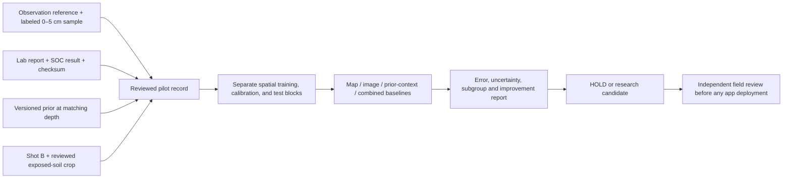

# Soil-carbon prediction pilot

## What is implemented

GSIP now has a runnable local research pipeline for **soil organic carbon (SOC), in g/kg, at 0–5 cm depth**, within one declared pilot region. It connects reviewed photo/lab pairs to versioned prior-map values, extracts image features, trains models, compares held-out performance, and produces an immutable experiment artifact. The mobile app explains the research status and displays observation references for matching field samples to laboratory records.

This implementation uses regularized linear regression (ridge regression), an interpretable machine-learning baseline. It does not contain a trained neural network, automated soil segmentation, calibrated spectroscopy, or a validated production model. RGB features are explicitly labeled uncalibrated. Existing card extraction is not treated as proof of calibrated soil reflectance.

No real paired dataset was supplied during implementation. Tests use explicitly synthetic data solely to check software behavior. No scientific accuracy, regional coverage, or public-release claim follows from those tests.

## Data flow



## Gather the pilot evidence

1. Choose one region and write down the intended soils, land uses, devices, lighting conditions, and depth. Freeze the evaluation plan before seeing test results.
2. Capture Shot B of the actual sampled soil. Record the GSIP observation reference, a unique physical sample label, the site, sampling depth, phone family, lighting, and wet/dry condition. Preserve the original linkage before submitting the sample to the lab.
3. Obtain a laboratory **organic carbon** measurement for that same sample at 0–5 cm. Do not substitute organic matter, total carbon without appropriate method interpretation, a map value, or a depth-integrated 0–30 cm result. Harmonize methods and units with the laboratory.
4. A reviewer checks the sample linkage and report. Record their name/ID, method, report file path and SHA-256, then set `verified=true`. The software checks file identity and structured fields; it cannot verify the report's scientific validity or prove that the sampled soil matches the photo.
5. A reviewer selects a rectangle containing exposed soil in the orientation-corrected JPEG and sets `roi_verified=true`. Coordinates are `[left, top, right, bottom]` in pixels. Keep cards, plants, stones and strong shadows out of that crop. Automatic segmentation and color correction are future work.
6. Attach a pinned prior source/version, SOC mean, and lower/upper bounds for the same depth. Prefer genuinely new lab samples independent of the source map's own training dataset.

Use `PILOT_SAMPLE_TEMPLATE.json` as a starting record. It is intentionally invalid until missing values and review flags are filled. A pilot dataset is JSON Lines: one complete record per line, one row per unique sample/submission. Image and lab-report paths are relative to the dataset directory and may not escape it. Keep this directory private; do not commit laboratory reports, personal identifiers, or exact locations.

The experiment rejects duplicate sample IDs, submission IDs and identical photo files. Near-duplicate photographs and copied-but-modified reports still require a human audit. Multiple photographs of one physical sample must not become independent labeled rows.

## Run locally

Use the project's Python environment (`uv sync --frozen` to install it).

```sh
# Print current readiness when no pilot dataset has been supplied.
uv run python -m ml status

# Generate the intentionally incomplete pairing template.
uv run python -m ml template

# Validate records and lab-report checksums.
uv run python -m ml status --dataset /path/to/private-pilot/pilot.jsonl

# Train once and save a new, immutable local experiment file.
uv run python -m ml train \
  --dataset /path/to/private-pilot/pilot.jsonl \
  --output /path/to/private-pilot/experiments/soc-001.json
```

Structural readiness does not mean enough data, correctly reviewed labels, usable photos, or sufficient geographical coverage. Training performs the additional image, duplication and split checks. Existing output filenames are refused rather than overwritten. The artifact contains the input fingerprint, feature version, model parameters, scope, split membership, comparison metrics, uncertainty calibration and hold reasons. Treat it as private research material; sample identifiers remain in the split manifest.

### Four comparisons

| Baseline        | Inputs and purpose                                                                                                                  |
| --------------- | ----------------------------------------------------------------------------------------------------------------------------------- |
| Map only        | The unchanged prior SOC mean. This is the basic performance floor.                                                                  |
| Image only      | Reviewed crop color statistics, brightness quantiles, surface gradients and clipping fraction.                                      |
| Prior + context | Prior mean plus lighting and moisture categories. Checks whether improvement comes merely from contextual adjustment.               |
| Combined        | All features; learns a correction to the prior mean. Must beat both map-only and prior-context baselines to show added image value. |

The combined model is fitted jointly; the system does not multiply correlated map, image and nearby-sample probabilities as if they were independent. GPS currently selects the input map context and determines spatial grouping. Terrain, climate covariates, nearby-label interpolation, and learned image embeddings are not implemented in this baseline.

All feature normalization and coefficients are fitted on training rows only. Repeated sites and H3-r4 cells are joined into indivisible spatial groups. Groups are deterministically assigned approximately 60% training, 20% calibration, and 20% test. This blocks direct site/cell leakage but has no geographical distance buffer; adjacent groups may remain correlated. Adding data can change this deterministic split, so preserve each artifact and do not treat repeated evaluation on familiar holdouts as independent confirmation.

## Uncertainty and research gates

The combined model uses separate calibration data to form an absolute-error interval with a nominal 90% coverage target. Calibration uses one maximum residual per spatial group. Finite-sample quantiles are used; too few independent calibration groups yield no finite interval. Coverage depends on exchangeability of calibration and future groups and is not guaranteed across regional/domain shift. Intervals and estimates are bounded to the allowed SOC range of 0–1000 g/kg.

Reports include MAE, RMSE, signed bias, block-balanced MAE, interval coverage/width, and separate phone/lighting/moisture results. Paired spatial-block bootstrap comparisons give a lower 95% confidence bound for average error reduction over both reference baselines.

The initial conservative numerical policy requires:

- At least 30 training blocks, 20 calibration blocks and 20 test blocks. With the current 60/20/20 split, roughly 100 independent blocks are needed to clear the counts. These are project screening thresholds, not a universal sample-size guarantee.
- No synthetic records anywhere in the experiment.
- At least 10% block-balanced MAE improvement over both map-only and prior-context models, with a positive lower bootstrap bound for both comparisons.
- At least 90% empirical test interval coverage and a finite calibration interval.

A small real pilot can still train and produce a useful diagnostic report; it remains `HOLD`. Passing these checks yields `RESEARCH_CANDIDATE`, always with `public_release_approved=false`. Subgroup coverage, spatial buffers, external replication, device/lighting transfer, practical interval width and scientific review remain deployment decisions. No automatic publication or retraining job was enabled.

## Local inference

Create an observation JSON containing the same fields as a pilot record except `lab`, then run:

```sh
uv run python -m ml predict \
  --observation /path/to/private-pilot/new-observation.json \
  --model /path/to/private-pilot/experiments/soc-001.json
```

Omitting `--model` returns `PRIOR_ONLY` with the supplied prior and no image correction. A held model also returns only the prior. Research inference refuses synthetic inputs, unfamiliar region/source/version, unknown phone/lighting/moisture groups, locations outside training H3-r3 coverage, unusable photos, and feature values outside observed training ranges. The feature-range screen cannot detect all distribution shifts. Accepted local results keep the prior and correction separate and are explicitly research-only.

Model files are trusted local research artifacts, not signed production releases. Do not expose the CLI as a public prediction service without authenticated, reviewed model deployment, input/resource limits, and real-device validation.

## Offline prior lookup

The pipeline accepts a local JSONL cache of previously extracted map values:

```json
{
  "h3_r8": "REPLACE_WITH_VALID_CELL",
  "sampling": "h3_r8_centroid",
  "prior": {
    "source": "SoilGrids",
    "version": "PINNED_SOURCE_VERSION",
    "property": "soc",
    "unit": "g/kg",
    "depth_top_cm": 0,
    "depth_bottom_cm": 5,
    "mean": null,
    "lower": null,
    "upper": null
  }
}
```

Replace placeholders with actual extracted values; the example intentionally fails validation. Store each record on one line. Values must describe the specified cell centroid rather than an arbitrary point somewhere inside the cell. Duplicate matches or mismatched versions fail closed.

```sh
uv run python -m ml prior --cache /path/to/priors.jsonl \
  --cell VALID_H3_R8 --source SoilGrids --version PINNED_SOURCE_VERSION
```

This is a version-pinned lookup helper, not a raster downloader or a deployed fallback for the existing prior worker. Preparing values from licensed raster snapshots, source attribution, and integrating that fallback into hosted ingestion remain separate work. It enables local experiments without live REST calls once the cache has been prepared.

## Next field milestone

Supply the pilot region and a first set of audited photo/sample/lab pairs. Run the baselines and inspect their hold reasons before deciding whether a larger model or a multispectral attachment would provide useful additional evidence. The important first result is independent improvement over the source map, not the number of images collected.

## Implementation validation — September 14, 2026

- 17 prediction tests passed, including rejected units/depths and unverified labels, changed report checksums, duplicate samples/photos, spatial grouping, held-out-label isolation, conservative interval quantiles, model holds, out-of-scope input, offline-cache version mismatch and immutable CLI outputs.
- The complete Python suite passed: 50 tests. Ruff and mypy passed across the project.
- The app/schema unit suite passed: 44 tests. TypeScript checks, ESLint, the UI-language guard and web builds passed.
- All 18 browser tests passed across mobile Chrome, mobile Safari/WebKit and desktop Chrome, including the updated Learn screen's accessibility scan.
- Android debug and iPhone simulator builds succeeded with the updated app screens.
- Current readiness: `AWAITING_PAIRED_LAB_DATA`. No real pilot pairs were supplied and no scientific model was approved.

These are software validation receipts. Synthetic fixtures do not establish prediction accuracy. Whole-repository formatting still has the previously noted issue in the untouched `REVIEW_SOL_BUILD_2026-07-22.md`; changed files are formatted.

## Method references

- [Spatial cross-validation research](https://arxiv.org/abs/2005.14263)
- [MAPIE and split-conformal uncertainty methods](https://proceedings.mlr.press/v204/cordier23a/cordier23a.pdf)
- [SoilGrids data, depth and uncertainty documentation](https://docs.isric.org/globaldata/soilgrids/)
- [Open Soil Spectral Library](https://docs.soilspectroscopy.org/libraries.html)
